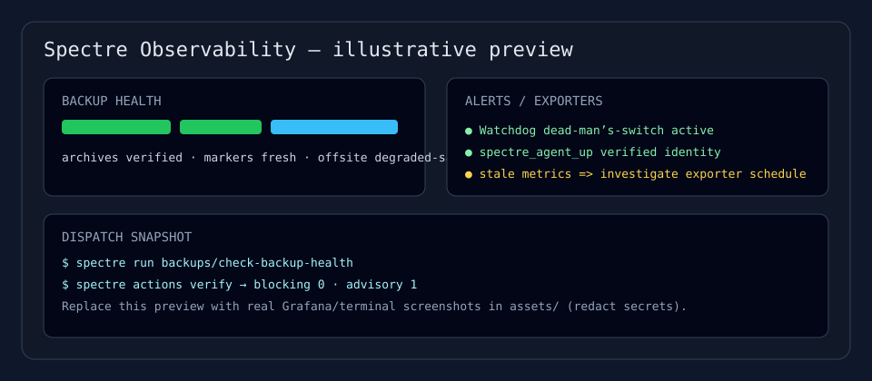
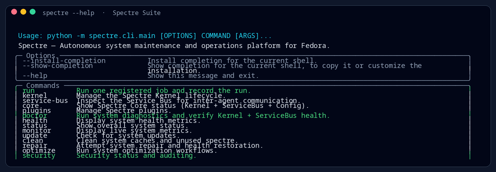
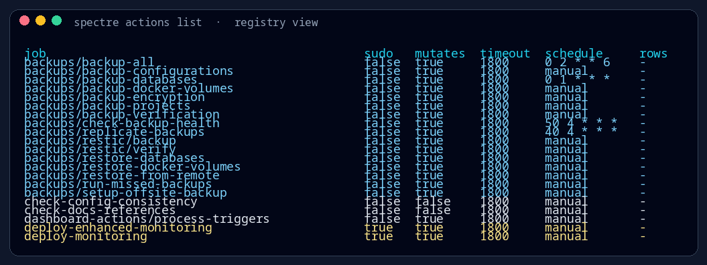
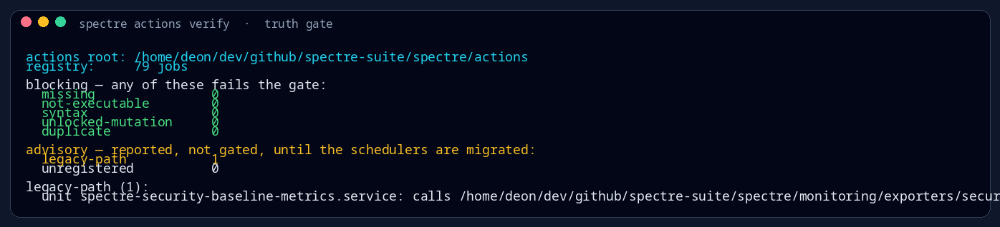
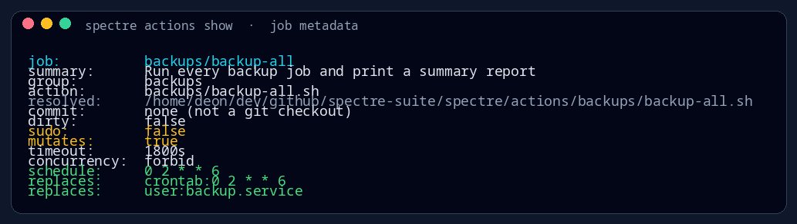
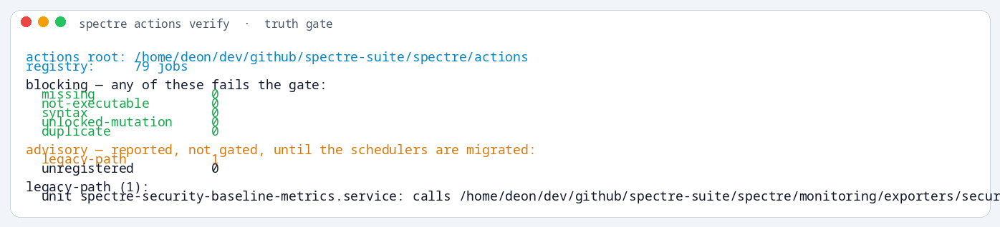

<h1 align="center">SPECTRE SUITE ☤</h1>

<p align="center">
  <strong>Linux system maintenance, backup, and monitoring automation — dispatched through one truthful CLI.</strong>
</p>

<p align="center">
  <a href="LICENSE"></a>
  <a href="pyproject.toml"></a>
  <a href="pyproject.toml"></a>
  <a href="https://www.linux.org/"></a>
</p>

<p align="center">
  <a href="https://github.com/bigwalkdoe/spectre-suite/actions/workflows/lint.yml"></a>
  <a href="https://github.com/bigwalkdoe/spectre-suite/actions/workflows/test-suite.yml"></a>
  <a href="https://github.com/bigwalkdoe/spectre-suite/actions/workflows/security-scanning.yml"></a>
  <a href="docs/superpowers/specs/2026-10-05-spectre-consolidation-design.md"></a>
</p>

<p align="center">
  <sub><code>╭─◆ backups/restic ─◆ prometheus/grafana/alertmanager ─◆ security &amp; maintenance ─◆ registry+provenance ◆─╮</code></sub>
</p>

---

```text
                          ╔══════════════════════════════════════════╗
                          ║   S P E C T R E   S U I T E   ·  ☤      ║
                          ╚══════════════════════════════════════════╝
                    backups · observability · hardening · maintenance · proof
```

## ▸ What Spectre Suite is

Spectre Suite is a consolidated Linux operations suite for **automated backups**, **restic snapshot workflows**, **monitoring/alerting** (Prometheus + Grafana + Alertmanager), **security/hardening helpers**, **maintenance jobs**, and **operational reporting**.

Instead of calling legacy scripts directly, scheduled and manual jobs run through the unified `spectre` dispatch surface:

```text
┌─[ dispatch fabric ]──────────────────────────────────────────────────────────┐
│                                                                              │
│   operator / timer / cron                                                    │
│          │                                                                   │
│          ▼                                                                   │
│   spectre run <job> ──► registry resolve ──► action/exporter ──► provenance  │
│          ▲                                                                   │
│          └── spectre actions verify  ·  registry ↔ disk ↔ scheduler [gate]  │
│                                                                              │
└──────────────────────────────────────────────────────────────────────────────┘
```

> [!IMPORTANT]
> **Treat runtime truth as authoritative.** Do not assume a README claim, schedule, or host state is current — verify with `spectre actions list` / `spectre actions verify`, `crontab -l`, and `systemctl list-timers --all` (including `--user`).

---

## ✦ Feature map

| Area | What it covers |
|---|---|
| **Dispatch** | `spectre run <job>`, `spectre actions list/show/verify`; registry metadata (`sudo`, `mutates`, `timeout`, `schedule_hint`, `concurrency`) and run provenance. |
| **Backups** | Database, Docker volume, config, and project backups; replication, encryption/verification helpers; missed-backup catch-up; adopted **restic** engine with tag-scoped retention and degraded-offsite behavior. |
| **Monitoring** | Prometheus + Grafana + Alertmanager, Blackbox exporter, business/security textfile exporters, restic marker metrics, dashboards/provisioning. |
| **Security** | IDS/IPS helpers (Suricata/OSSEC via `security/install-ids-ips`), Docker/API/network hardening actions, dependency/image scan helpers, Trivy image scan and SBOM/file-integrity baseline actions, OPA policies (including compatibility/version/admission reports), Spectre agent security metrics with port/identity collision detection. |
| **Maintenance** | Cache/temp/download/resource cleanup, disk/performance checks, DB vacuum, system health, compliance/audit helpers, and safe automated self-maintenance (scheduled backup trimming/prune, 15-minute posture maintenance). |
| **Network & performance** | VPN/network hardening/monitoring and optimization/right-sizing actions where implemented (review `sudo`/`mutates`). |
| **ML (optional)** | ML anomaly pipeline/actions where dependencies/config are present. |

<details>
<summary><strong>Not implemented in this repository</strong> (avoid assuming these exist)</summary>

Loki, Promtail, Wazuh orchestration/management (a `security/baseline/check-wazuh-status` status check exists), OWASP ZAP orchestration, SonarQube orchestration, PgBouncer/read-replica/Vault deployment, or k6/Locust harnesses.

</details>

---

## ◈ Visuals & screenshots

```text
╔═◈═ preview ═════════════════════════════════════════════════════════════════╗
║  terminal captures · illustrative observability · safe capture workflow     ║
╚═════════════════════════════════════════════════════════════════════════════╝
```

<p align="center">
  
</p>

<table>
  <tr>
    <td align="center" width="33%">
      <strong>CLI surface</strong><br>
      
    </td>
    <td align="center" width="33%">
      <strong>Action registry</strong><br>
      
    </td>
    <td align="center" width="34%">
      <strong>Truth gate</strong><br>
      
    </td>
  </tr>
  <tr>
    <td align="center" width="33%">
      <strong>Job metadata</strong><br>
      
    </td>
    <td align="center" colspan="2">
      <sub><code>◆ rendered locally · ◆ real command output · ◆ themes/ANSI modes available</code></sub><br><br>
      
      <br><sub>light-theme sample (generator: <code>--theme light --suffix-theme</code>)</sub>
    </td>
  </tr>
</table>

```text
╭─[ capture workflow ]────────────────────────────────────────────────────────╮
│ Terminal PNGs are regenerated locally from real `spectre` output:           │
│   python3 assets/render_terminal_screenshots.py --commands all              │
│   python3 assets/render_terminal_screenshots.py --theme dark --theme light  │
│   python3 assets/render_terminal_screenshots.py --color ansi --theme nord   │
│                                                                             │
│ Grafana/Alertmanager: use the browser/desktop workflow in assets/README.md  │
│ on a SAFE, redacted/demo view. A local monitoring stack may expose targets, │
│ instance labels, internal IPs, routes, or config — do not commit live      │
│ dashboard/status captures without review and redaction.                     │
╰─────────────────────────────────────────────────────────────────────────────╯
```

---

## ▸ Quick start

```text
  ◆ inspect  →  ◆ verify  →  ◆ dispatch  →  ◆ review provenance
      │             │            │                  │
      └─────────────┴────────────┴─ truth before trust ─┘
```

```bash
git clone https://github.com/bigwalkdoe/spectre-suite.git
cd spectre-suite

# Inspect available jobs and registry/host consistency
python3 -m spectre.cli.main actions list
python3 -m spectre.cli.main actions verify

# Run a job through the dispatcher
python3 -m spectre.cli.main run maintenance/system-health-check
python3 -m spectre.cli.main run backups/backup-all -- --help
```

If you have the package installed in an environment where `spectre` is on `PATH`, use `spectre ...` directly.

### Install / host integration notes

```text
╭─ caution ───────────────────────────────────────────────────────────────────╮
│ install.sh is root/host-mutating. Review before use.                        │
│ Prefer the installed `spectre` CLI and systemd timers that invoke          │
│ `spectre run <job>`. Consolidation intent: only `spectre` belongs in       │
│ /usr/local/bin (not arbitrary scripts).                                     │
╰─────────────────────────────────────────────────────────────────────────────╯
```

For sleep/resume-safe catch-up (checks health first; runs only when stale):

```bash
./spectre/actions/systemd/install-backup-catchup-timer.sh
```

---

## ▸ Unified dispatch model

```text
spectre/actions/<group>/<job>.sh          ← canonical job implementations
spectre/monitoring/exporters/*            ← canonical exporter implementations
spectre/policies/*                        ← OPA rego + baseline.json (real dir)
spectre/dispatch/registry_data.json        ← registry source of truth (with dispatch modules)
```

```bash
spectre actions list
spectre actions show backups/backup-all
spectre actions verify
spectre run backups/backup-all
```

**C1 complete:** no tracked legacy `scripts/` compatibility tree (`git ls-files scripts` = 0). Use `spectre run <job>` and canonical paths. CI guardrails block reintroducing tracked `scripts/` paths.

---

## ▸ Schedule reference (host-dependent)

Scheduled jobs should have **one scheduler path per job** and invoke `spectre run <job>`. Exact schedules vary by host — confirm with `crontab -l`, `systemctl list-timers --all`, `systemctl --user list-timers --all`, and `spectre actions verify`.

| Typical job | `spectre run` target | Notes |
|---|---|---|
| Database backup | `backups/backup-databases` | daily / as scheduled |
| Full backup | `backups/backup-all` | weekly / as scheduled |
| Backup health check | `backups/check-backup-health` | verifies archives/markers, not just logs |
| Missed-backup catch-up | `backups/run-missed-backups` | persistent timer; checks health before running |
| Adopted restic backup | `backups/restic/backup` | local-first, tag-scoped |
| Adopted restic verify | `backups/restic/verify` | scheduled verify |
| DB vacuum | `maintenance/vacuum-databases` | daily / as scheduled |
| Cleanup / performance | `maintenance/*`, `performance/*` | as configured |
| Metrics exporters | `prometheus/*-metrics-exporter` | cron/timer-driven textfile exporters |

> **Cron does not catch up after sleep.** Use persistent systemd timers for catch-up-sensitive jobs.
> **Health over logs:** exporters/alerts should key off verified health signals.

---

## ▸ Monitoring stack

Credentials are **required**. `docker compose` refuses to start without them.

```bash
cp .env.example .env
$EDITOR .env   # GRAFANA_ADMIN_PASSWORD, POSTGRES_PASSWORD, REDIS_PASSWORD, POSTGRES_EXPORTER_DSN

docker compose -f docker-compose.monitoring.yml up -d
```

```text
Default local access points (verify compose bindings on your host):
  Grafana      → http://localhost:3002
  Prometheus   → http://localhost:9090
  Alertmanager → http://localhost:9093
  Blackbox     → http://localhost:9115
  Dashboard    → http://localhost:8081
```

> **Upgrading an existing deployment:** `POSTGRES_PASSWORD` initializes a new `postgres-data` volume only. To rotate an existing volume, use `ALTER USER ... PASSWORD ...` or recreate the volume (data loss).

### Alertmanager notifications

Alertmanager config does not do `${VAR}` substitution. Use the notification setup flow (writes a gitignored secret file, mode `0600`):

```bash
SLACK_WEBHOOK_URL='https://hooks.slack.com/services/...' \
  spectre run setup-notification-channels -- --test
```

`Watchdog` acts as a dead-man’s-switch alert. See `prometheus/alertmanager-secrets/README.md`.

---

## ▸ Restic (adopted)

The adopted restic engine is **local-first, tag-scoped** and treats offsite failures as **degraded** (they must not block local backup success). Existing backup producers and `check-backup-health.sh` remain intact.

```bash
# Store secrets outside the repo
cp config/backups/restic/env.example "$HOME/.secrets/spectre-suite-backups.env"
chmod 600 "$HOME/.secrets/spectre-suite-backups.env"
export RESTIC_CONFIG="$HOME/.secrets/spectre-suite-backups.env"

spectre run backups/restic/backup
spectre run backups/restic/verify
# Space reclamation (tag-scoped prune; preview with -- --dry-run)
spectre run backups/restic/prune
```

Retention is configurable in `$RESTIC_CONFIG` (`RESTIC_KEEP_HOURLY=24`, `RESTIC_KEEP_DAILY=30`, `RESTIC_KEEP_WEEKLY=12`, `RESTIC_KEEP_MONTHLY=12`, `RESTIC_KEEP_LAST=1`, defaults preserved) while forget/prune remains tag-scoped. Optional user timers: `spectre/actions/systemd/install-restic-timer.sh`, `spectre/actions/systemd/install-restic-verify-timer.sh`, `spectre/actions/systemd/install-restic-prune-timer.sh` (daily prune), `spectre/actions/systemd/install-backup-trim-timer.sh` (daily conservative local backup artifact trimming via `spectre run backups/trim-backup-artifacts -- --dry-run`). **Never commit passwords/keys/backend credentials.** See `docs/migration/2026-11-06-absorb-spectre-backup.md`.

---

## ▸ Security & metrics notes

```bash
# Examples (review sudo/mutates before running)
spectre run security/scan-docker-images
spectre run security/scan-dependencies
sudo spectre run security/run-security-hardening
opa check spectre/policies/
```

`spectre run prometheus/security-metrics-exporter` (scheduled) publishes Spectre agent findings as node-exporter textfile metrics. Key signals include `spectre_agent_up` / `spectre_agent_up_reason`; finding counts are omitted (not zeroed) when agent state is unknown/untrusted. The agent API is fail-closed (`X-API-Key` required). Configure via `SPECTRE_AGENT_URL`, `SPECTRE_API_KEY_FILE` (default `<repo>/.spectre-api-key`, mode `0600`), `SPECTRE_TIMEOUT`.

`security/security-posture-maintenance` runs as a lightweight 15-minute self-maintenance cycle (user timer: `spectre/actions/systemd/install-security-posture-maintenance-timer.sh`) to refresh posture/status signals and apply only safe, idempotent fixes (state/export refresh, managed stale-temp cleanup). Use `-- --dry-run` or `-- --check-only` to preview; no service restarts or risky config/network changes by default.

---

## ◇ Project layout

```text
spectre-suite/
├── assets/                      # README visuals (banner, previews, screenshot placeholders)
├── spectre/
│   ├── actions/                 # Canonical dispatched job implementations
│   ├── dispatch/                # Registry, resolve, verify, run records/provenance
│   ├── monitoring/              # Prometheus/Grafana assets, exporters
│   ├── policies/                # OPA policies + baseline.json
│   └── cli/, agents/, ...       # Python package (CLI, services, API/TUI/daemon)
├── prometheus/                  # Monitoring config/rules/alertmanager assets
├── grafana-dashboards/          # Dashboards/provisioning assets
├── config/                      # Templates (including restic templates)
├── systemd/                     # Unit/timer helpers
├── docs/                        # Runbooks, migration notes, specs/plans
├── tests/                       # bash suite + agent tests
├── docker-compose.monitoring.yml
└── pyproject.toml
```

---

## ▸ Testing

```bash
bash tests/run_tests.sh

# Dispatcher/registry checks
python3 -c "from spectre.dispatch.verify import verify, read_host_inventory; print(verify(read_host_inventory()))"
```

---

## ▸ Documentation

| Document | Purpose |
|---|---|
| [`docs/superpowers/specs/2026-10-05-spectre-consolidation-design.md`](docs/superpowers/specs/2026-10-05-spectre-consolidation-design.md) | Consolidation design/spec |
| [`docs/migration/2026-11-06-phase2-3-repointing-runbook.md`](docs/migration/2026-11-06-phase2-3-repointing-runbook.md) | Phase 2/3 repointing status |
| [`docs/migration/2026-11-06-absorb-spectre-backup.md`](docs/migration/2026-11-06-absorb-spectre-backup.md) | Restic absorption/cutover runbook |
| [`docs/DISASTER_RECOVERY.md`](docs/DISASTER_RECOVERY.md) | RTO/RPO and recovery procedures |
| [`docs/RUNBOOKS.md`](docs/RUNBOOKS.md) | Incident runbooks |
| [`docs/TESTING_AND_CICD.md`](docs/TESTING_AND_CICD.md) | Test suite and CI/CD |
| [`docs/ADVANCED_SECURITY_FEATURES.md`](docs/ADVANCED_SECURITY_FEATURES.md) | IDS/IPS, threat detection notes |
| [`docs/TROUBLESHOOTING.md`](docs/TROUBLESHOOTING.md) | Troubleshooting guide |

---

## ▸ License

MIT — see [`LICENSE`](LICENSE).

<p align="center">
  <sub>┄┄┄  spectre suite  ·  keep runtime truth authoritative  ·  <code>spectre actions verify</code>  ┄┄┄</sub>
</p>
